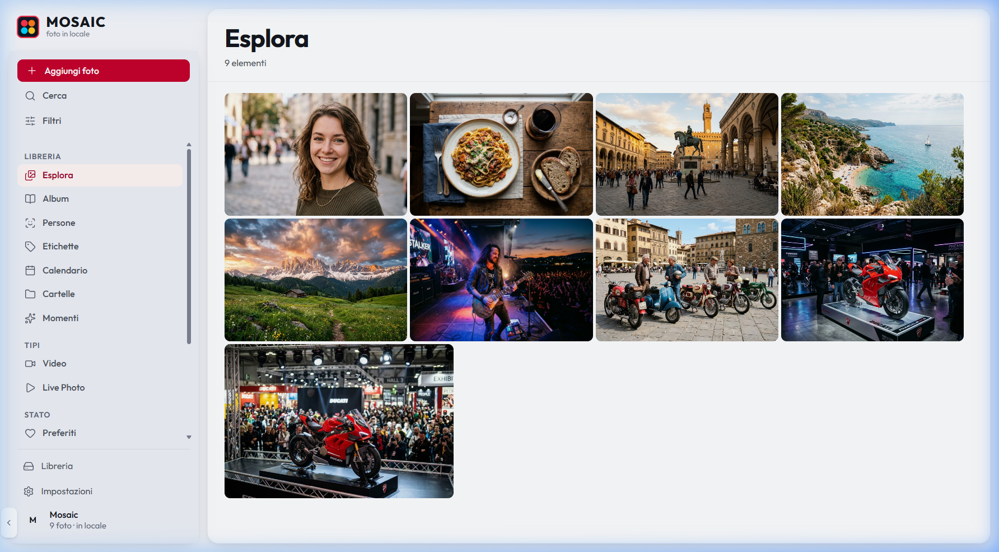
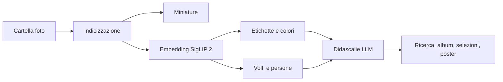
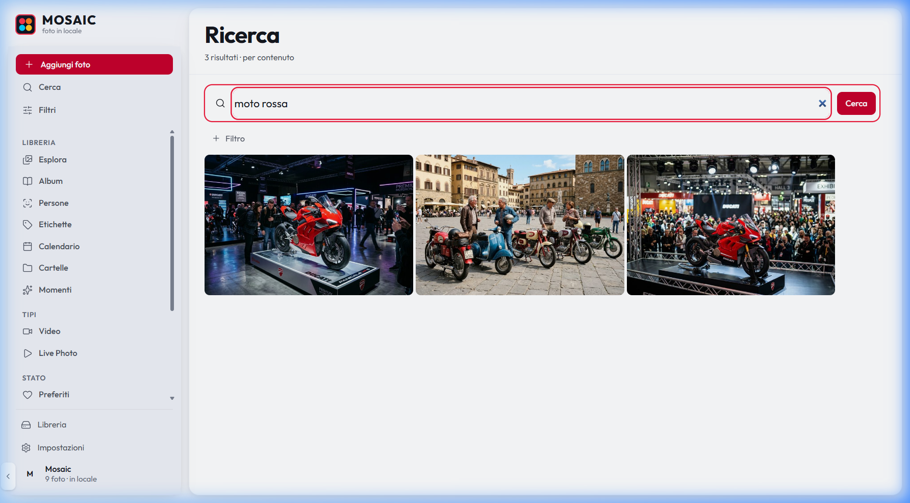
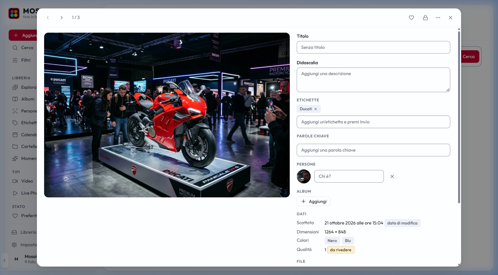
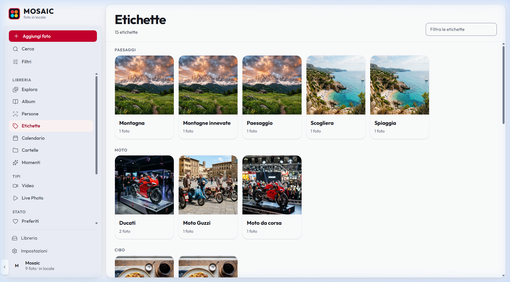
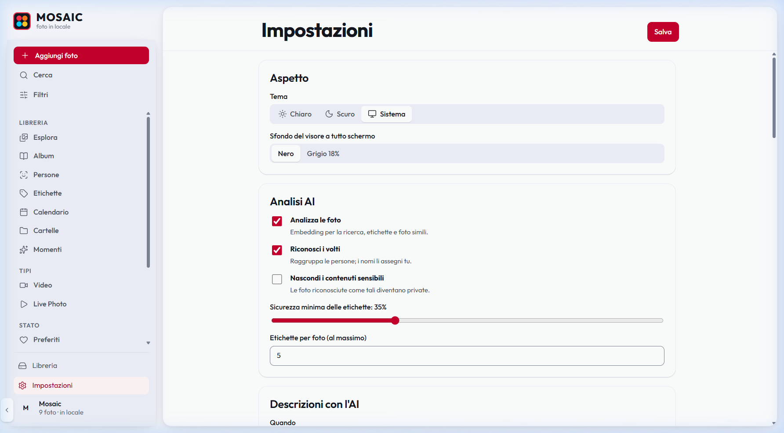

# Mosaic 2



*Esplora, la pagina iniziale di Mosaic (screenshot reale con le foto di esempio in `docs/mock_photos/`).*

Gestore di foto e video **completamente locale**: niente Docker e niente cloud. È una ricostruzione del vecchio Mosaic che adotta le strategie di [PhotoPrism](https://github.com/photoprism/photoprism):
- indicizzazione incrementale con stack RAW+JPEG+XMP+video;
- priorità delle fonti dei metadati;
- volti con clustering;
- smart album e filtri di ricerca;
- video e Live Photo.

In più ci sono un motore di embedding moderno e un LLM locale incluso.

> **Stato:** implementato e verificato con test (284 Python, copertura 90%; 66 frontend) e con una prova end-to-end su una libreria reale. Restano da provare RAW veri, volti su foto con persone e l'installazione su un PC vergine: dettagli in [VERIFICATION.md](docs/rebuild/VERIFICATION.md).

## Cosa fa

- **Ricerca in italiano per contenuto**, come "moto rossa sul palco", con **SigLIP 2** multilingue (ONNX, su CPU), combinata con filtri `label:`, `person:`, `year:`, `camera:`, `color:`, `live:` e altri.
- **Foto simili spiegate**, con un punteggio diviso su soggetto, inquadratura, palette e contesto.
- **Etichette e categorie automatiche** zero-shot, con un vocabolario modificabile (`models/labels_it.yaml`).
- **Volti e persone**, solo per chi è in primo piano (la folla sullo sfondo si ignora): rilevamento YuNet, embedding SFace, clustering DBSCAN, assegnazione dei nomi.
- **Didascalie, titoli e parole chiave in italiano** generati da un LLM locale incluso (Qwen3-VL-2B su llama.cpp). Per andare molto più veloci, in **Impostazioni → Descrizioni con l'AI** si può attivare (facoltativo, spento di default) un servizio cloud gratuito: incolla la chiave di NVIDIA ([build.nvidia.com](https://build.nvidia.com)) e/o di OpenRouter ([openrouter.ai/keys](https://openrouter.ai/keys)). Mosaic prova prima NVIDIA, poi OpenRouter, poi il modello locale; solo le didascalie escono dal PC (vedi D-19 in `docs/rebuild/DECISIONS.md`).
- **Rinomina automatica** degli originali (`0001_ducati-panigale-rossa.jpg`). Rinomina l'intero stack, con journal, dry-run e **rollback**.
- **Video e Live Photo**: anteprime, transcodifica quando serve, streaming.
- **Crea selezione** da un album o da una cartella: scegli quante foto e il formato, Mosaic prende quelle venute meglio, diverse tra loro, lungo tutto l'evento e con più persone possibile, e le salvi come album.
- **Poster a mosaico** stile Mondrian dalla selezione: anteprima dal vivo, formati da A4 a 70×100, file pronto da stampare in `Immagini\Mosaic`.
- **Scarica ed esporta** da qualsiasi pagina con un solo dialogo: zip da scaricare o cartella, formato (originale, JPEG, PNG, WebP), qualità, dimensione, numerazione, ritaglio e miglioramento. **Ctrl+A** seleziona tutto, **Ctrl+Z / Ctrl+Y** annullano e ripetono (D-36).
- **Aggiornamento senza reset**: lanciando il nuovo `MosaicSetup.exe` su un PC con Mosaic già installato si sostituisce solo il programma; foto, catalogo, persone, modelli e impostazioni restano (con copia di sicurezza del catalogo prima di aggiornarlo).
- **Trascina e rilascia** foto, video, cartelle e file .zip nella finestra: le cartelle si collegano dove sono, senza copie.
- **Attività sempre visibili**: barra di progresso con tempo rimanente, pannello con le fasi dell'elaborazione.
- **Sincronizzazione con il computer** (Impostazioni): Mosaic solo come interfaccia, oppure eliminare in Mosaic = Cestino di Windows e viceversa.
- **Organizzazione**: album, moments, calendario, cartelle, preferiti, privato, archivio, review, duplicati e quasi-duplicati.
- **Migrazione** del catalogo curato del vecchio Mosaic, abbinato per SHA-256.

## Come funziona

1. **Scegli la cartella** delle foto al primo avvio (o trascinala nella finestra). Gli originali restano dove sono.
2. **Mosaic indicizza**: legge i metadati (exiftool), raggruppa gli stack RAW+JPEG+XMP, genera le miniature e calcola gli embedding di contenuto.
3. **L'analisi** aggiunge etichette, colori, volti, moments e, se vuoi, didascalie, titoli e parole chiave in italiano.
4. **Cerchi, organizzi, rinomini, stampi**: tutto in locale, con il database in `data/`.



## Anteprima

Gli screenshot di questa sezione sono **reali**: sono stati fatti con Mosaic aperto nel browser (`http://127.0.0.1:8000`) dopo aver indicizzato 9 foto di esempio create con un generatore di immagini AI (non sono foto di persone vere), che trovi in [`docs/mock_photos/`](docs/mock_photos). Per riprodurli:

```bash
.venv/Scripts/python -m mosaic index docs/mock_photos   # meglio su una copia: Mosaic rinomina i file
.venv/Scripts/python -m mosaic serve
```

### Ricerca in italiano per contenuto



Scrivi cosa cerchi con parole tue (qui "moto rossa"): Mosaic confronta il testo con il contenuto delle foto e restituisce le tre moto, non per nome del file. Si combina con i filtri (`+ Filtro`) come `label:`, `year:` o `color:`.

### Il visore di una foto



Cliccando una foto si apre il visore: a sinistra l'immagine, con il riquadro rosso sul volto trovato; a destra tutto quello che Mosaic sa della foto. Titolo, didascalia, etichette e parole chiave si modificano a mano, i volti si nominano ("Chi è?"), si aggiunge la foto a un album e si leggono data, dimensioni, colori dominanti e qualità. In alto ci sono foto precedente/successiva, preferito, privato e il menu delle altre azioni.

### Etichette automatiche



Senza che tu scriva niente, le foto ricevono etichette (Montagna, Spiaggia, Ducati, Cibo…) raggruppate per categoria: Paesaggi, Moto, Cibo. Il vocabolario si modifica in `models/labels_it.yaml`.

### Impostazioni



Tema chiaro, scuro o di sistema, scelta di cosa analizzare (contenuto, volti, contenuti sensibili), soglia di sicurezza delle etichette e descrizioni con l'AI.

## Come è fatta l'app

### L'interfaccia

La barra laterale ha sempre le stesse voci:

| Gruppo | Voci | Cosa mostrano |
|---|---|---|
| Azioni | **Aggiungi foto**, **Cerca**, **Filtri** | importare foto o cartelle, ricerca per contenuto, filtri combinabili |
| Libreria | **Esplora**, **Album**, **Persone**, **Etichette**, **Calendario**, **Cartelle**, **Momenti** | i modi per navigare le foto: tutte, per album, per persona, per etichetta, per mese, per cartella o per evento |
| Tipi | **Video**, **Live Photo** | solo video o solo Live Photo |
| Stato | **Preferiti**, **Da rivedere**, **Duplicati**, **Privato**, **Archivio** | le foto messe da parte o da controllare |
| In fondo | **Libreria**, **Impostazioni** | cartelle indicizzate, elaborazione e manutenzione; opzioni dell'app |

La pagina **Libreria** elenca le cartelle collegate (`Cerca nuove foto`, `Rielabora tutto`) e il registro delle attività: indicizzazione, analisi AI, riconoscimento volti, album automatici, rinomina e backup.

### Il percorso di una foto

```text
cartella ──> indicizzazione ──> miniature ──> analisi AI ──> volti ──> momenti ──> rinomina ──> backup
               (exiftool,         (cache in     (SigLIP 2:    (YuNet +   (album       (journal    (YAML dei
                stack, SHA-256)    data/)        etichette,    ArcFace)   automatici) e rollback) dati manuali)
                                                 colori)
```

Ogni fase è un lavoro in coda: lo stesso percorso parte da `mosaic index` o dal pulsante **Aggiungi foto**, e il suo avanzamento si vede nella barra di progresso e nel registro della pagina Libreria.

### Il codice

```text
frontend/ (Vue 3)  ──HTTP──>  mosaic/api (FastAPI)  ──>  mosaic/pipeline + jobs
  pages/ componenti            routes_*.py                  index  meta  thumbs  ai  llm
                                                            search organize video
                                                                 │
                                                          data/ (SQLite + cache)
```

- `frontend/src/pages/`: una pagina per ogni voce della barra (`LibraryPage.vue`, `SearchPage.vue`, `PeoplePage.vue`, `SettingsPage.vue`…).
- `mosaic/api/`: le rotte, divise per argomento (`routes_photos`, `routes_library`, `routes_collections`, `routes_poster`…).
- `mosaic/pipeline.py` e `mosaic/jobs/`: la catena di fasi e la coda dei lavori.
- `mosaic/index`, `meta`, `thumbs`, `ai`, `llm`, `search`, `organize`, `video`: un modulo per ogni compito.
- `mosaic/desktop.py`: la finestra nativa; `mosaic/cli.py`: i comandi da riga di comando.

## Requisiti

- Windows 10/11, Python ≥ 3.12. È testato con 3.14.4.
- Circa 3,5 GB di spazio per modelli e programmi, più la cache delle miniature (circa 0,3 MB per foto).
- Non serve installare nient'altro: exiftool, ffmpeg e llama.cpp vengono scaricati in versione portabile in `runtime/`.

## Installazione rapida

1. Scarica o copia `MosaicSetup.exe` e avvialo.
2. Scegli il disco: servono circa 6 GB liberi (4 GB senza LLM).
3. Attendi: l'installer prepara Python, dipendenze, modelli e collegamenti.
4. Apri **Mosaic** dal Desktop o dal menu Start e scegli la cartella delle foto.

Da sorgente (sviluppo):

```bash
git clone https://github.com/joaopinton/Mosaic.git
cd Mosaic
powershell -ExecutionPolicy Bypass -File setup.ps1
.venv/Scripts/python -m mosaic serve
```

Poi apri `http://127.0.0.1:8000`.

## Installazione su un altro PC

Copia `dist/MosaicSetup.exe` (circa 4 MB) sul PC di destinazione e avvialo. L'installer:

1. chiede in quale disco installare (servono circa 6 GB liberi, 4 GB senza LLM) e crea la sottocartella `Mosaic`;
2. controlla il PC (Windows 10/11 a 64 bit, spazio, RAM, rete e proxy, componenti Visual C++) e si adatta: con poca RAM o poco spazio salta il modello LLM, che si può aggiungere dopo rilanciando l'installazione;
3. cerca un Python **3.12-3.14** a 64 bit (launcher `py`, registro, `PATH`, cartelle comuni). Uno più nuovo (3.15) o più vecchio, quello del Microsoft Store o uno a 32 bit si scartano, perché numpy, onnxruntime e rawpy non hanno le ruote per le altre versioni. Se non ce n'è uno adatto, o se con quello trovato le dipendenze non si installano, scarica l'installer ufficiale di Python 3.14.4 da python.org, ne verifica la firma digitale e lo installa dentro la cartella di Mosaic (senza toccare il PATH); se anche questo non riesce prova con winget;
4. crea `.venv` (la ricrea se il suo Python è sparito) e installa le dipendenze, con nuovi tentativi in caso di rete instabile, poi controlla che si carichino davvero;
5. scarica e verifica con SHA-256 i modelli e i programmi portabili (SigLIP 2, YuNet, SFace, ArcFace, exiftool, ffmpeg, llama.cpp, Qwen3-VL-2B);
6. controlla Microsoft Edge WebView2 (già presente su Windows 11) e, se manca, lo installa dal sito Microsoft dopo averne verificato la firma;
7. crea i collegamenti sul Desktop e nel menu Start, registra la disinstallazione in Impostazioni > App e avvia Mosaic.

Serve la connessione a Internet solo durante l'installazione. Windows SmartScreen può avvisare perché l'exe non è firmato: "Ulteriori informazioni" → "Esegui comunque". Il log è in `setup.log` nella cartella di installazione. Se un download si interrompe, rilancia `setup.ps1` dalla cartella installata: riprende da dove era arrivato.

Opzioni di `setup.ps1`: `-InstallDir <cartella>`, `-PythonPath <python.exe>` (usa un Python scelto da te, 3.12-3.14), `-NoLLM`, `-SkipAssets`, `-Check` (solo controllo: mostra PC, Python adatti e quelli scartati con il motivo), `-Quiet`.

Se l'installazione fallisce, il messaggio dice perché e una copia del log è sul Desktop (`mosaic-setup-log.txt`).

```bash
powershell -ExecutionPolicy Bypass -File setup.ps1 -Check
```

Per ricostruire l'exe (usa IExpress e il compilatore C# di .NET Framework, entrambi già inclusi in Windows):

```bash
powershell -ExecutionPolicy Bypass -File installer/build_installer.ps1
```

Stato degli asset in qualsiasi momento:

```bash
.venv/Scripts/python -m mosaic.assets status
```

## Uso

Mosaic è un'app desktop: il doppio clic su `Mosaic.exe` (o sul collegamento "Mosaic" nel Desktop o nel menu Start) apre una finestra nativa con Edge WebView2. Il server locale (`127.0.0.1:8000`) gira dentro la stessa app e si ferma quando chiudi la finestra. Se WebView2 non è disponibile, Mosaic si apre in una finestra di Edge senza barra degli indirizzi. Al primo avvio una procedura guidata chiede la cartella delle foto. `python -m mosaic serve` avvia ancora la sola versione nel browser.

Per ricompilare solo `Mosaic.exe`:

```bash
powershell -ExecutionPolicy Bypass -File installer/build_launcher.ps1
```

Da riga di comando:

```bash
.venv/Scripts/python -m mosaic index "D:\Foto"
.venv/Scripts/python -m mosaic search "moto rossa sul palco"
.venv/Scripts/python -m mosaic similar <foto>
.venv/Scripts/python -m mosaic rename --dry-run
.venv/Scripts/python -m mosaic rollback --all
.venv/Scripts/python -m mosaic status
```

`mosaic index` esegue tutta la catena: indicizzazione, miniature, analisi, volti, moments, didascalie (se l'LLM è attivo), rinomina e backup. Gli altri comandi (`analyze`, `faces`, `moments`, `caption`, `cleanup`, `import`, `import-legacy`, `export`, `config`, `serve`) fanno un passo alla volta.

Esempio di output (dati di esempio):

```text
$ python -m mosaic index "D:\Foto\PadovaMotoDays"
[1/7] Indicizzazione   ████████████████████ 1.248 file (412 stack RAW+JPEG)
[2/7] Miniature        ████████████████████ 1.248/1.248
[3/7] Analisi          ████████████████████ etichette, colori, embedding
[4/7] Volti            ████████████████████ 386 volti in primo piano, 27 persone
[5/7] Moments          ████████████████████ 18 moments
[6/7] Didascalie       ████████████████████ 1.248 descrizioni (locale)
[7/7] Rinomina         ████████████████████ 1.248 file (journal salvato)
Fatto in 41 min.

$ python -m mosaic rename --dry-run
0001_ducati-panigale-rossa.jpg   <-  DSC_4821.jpg (+ DSC_4821.xmp)
0002_palco-concerto-chitarrista.jpg  <-  DSC_4822.jpg
0003_piazza-prato-della-valle.jpg    <-  DSC_4830.jpg
```

## Struttura

| Cartella | Contenuto |
|---|---|
| `mosaic/` | pacchetto Python (backend, CLI, worker) |
| `frontend/` | interfaccia Vue 3 |
| `models/`, `runtime/` | modelli e programmi portabili, scaricati da `assets.yaml` e non versionati |
| `data/` | database e cache, spostabile da `config.yaml` |
| `_legacy/` | il vecchio Mosaic, archiviato e intatto |
| `docs/rebuild/` | documentazione della ricostruzione |
| `docs/images/` | screenshot dell'app usati in questo README |
| `docs/mock_photos/` | foto di esempio (generate con AI) per provare l'app |

## Documentazione

- [PIANO.md](docs/rebuild/PIANO.md): fasi, file, schema, API, criteri di accettazione.
- [UI_SPEC.md](docs/rebuild/UI_SPEC.md): stile dell'interfaccia (sidebar, transizioni, icone, token) ripreso da sift-argus-v3.
- [FEATURE_LEDGER.md](docs/rebuild/FEATURE_LEDGER.md): tutte le funzioni, con origine (Mosaic o PhotoPrism) ed evidenza nel sorgente.
- [DECISIONS.md](docs/rebuild/DECISIONS.md): le scelte di progetto, separate dal comportamento osservato.
- [VERIFICATION.md](docs/rebuild/VERIFICATION.md): verifica finale funzione per funzione.

## Domande frequenti

**Le mie foto escono dal PC?** No. Tutto gira in locale. L'unica eccezione è facoltativa e spenta di default: le didascalie con NVIDIA/OpenRouter (vedi sopra).

**Mosaic modifica i miei originali?** Può rinominarli (con journal, dry-run e rollback). Fai comunque una copia di sicurezza.

**Serve una GPU?** No, tutto funziona su CPU. Con 8 GB di RAM l'LLM locale impiega circa 17 s a foto.

**Posso usarlo per lavoro?** No: la licenza è solo per uso personale (vedi sotto).

## Licenza

Mosaic è distribuito con una **licenza per uso personale e non commerciale**: il testo completo è in [LICENSE](LICENSE). Puoi usarlo e modificarlo sulle tue foto; non puoi venderlo, offrirlo come servizio né usarlo in attività commerciali o professionali.

Questa scelta deriva dallo stack: alcuni componenti hanno licenze che ammettono solo l'uso personale o non commerciale (ArcFace/InsightFace, Qwen Research).

### Licenze dei componenti

Le strategie di PhotoPrism (AGPL-3.0) sono reimplementate senza copiarne il codice. Licenze dei modelli e dei programmi:

| Componente | Licenza | Uso |
|---|---|---|
| SigLIP 2 | Apache-2.0 | libero |
| YuNet | MIT | libero |
| SFace | Apache-2.0 | libero |
| ArcFace (InsightFace buffalo_l) | InsightFace | **solo non commerciale** |
| Qwen3-VL-2B (LLM predefinito) | Apache-2.0 | libero |
| Qwen2.5-VL-3B (LLM opzionale) | Qwen Research | **solo uso personale** |
| llama.cpp | MIT | libero |
| exiftool | Artistic/GPL | programma separato |
| ffmpeg | GPL | programma separato |

Dettagli in [DECISIONS.md](docs/rebuild/DECISIONS.md), D-14.
